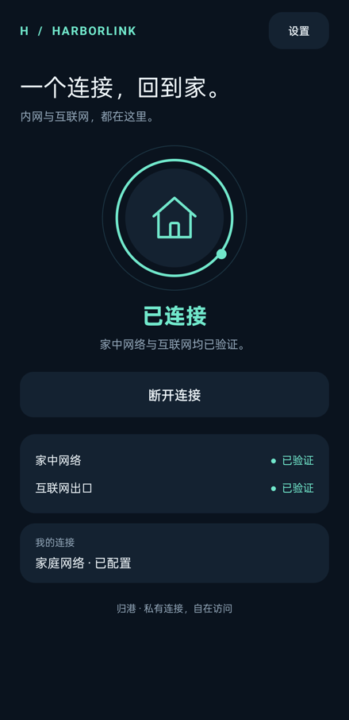

# HarborLink · 归港

**一个连接，回到家中的网络。**

HarborLink 是一个 Android 客户端：内置 ZeroTier 隧道，通过家中 NAS 上的 mihomo 网关，同时访问家庭内网和互联网。只占用一个 Android VPN，无需同时运行官方 ZeroTier 客户端。



## 日常使用

- **一个按钮**：连接、取消、断开，界面跟随真实状态变化。
- **自动验收连接**：获得虚拟地址后，在 VPN 网络内检查 NAS TCP 端口，再执行经过系统证书验证的 HTTPS 请求。两项通过才显示“已连接”。
- **持续检查**：后台服务每 20 秒发起检测。失败显示“连接待恢复”；网络切换会清除旧结果，重新验证。检测耗时另计。
- **默认用户模式**：仅显示连接状态、家庭网络与互联网可用性。设置中开启开发者模式后，才显示节点、路径、错误与诊断工具。
- **扫码入网**：相机或本地图片识别二维码，确认后填入设置；也可显示当前网络的入网码供其他设备扫描。
- **Moon 支持**：设置页只显示配置数量，点击后管理简短节点列表；完整 World / Seed 仅在开发者模式显示。支持最多 8 个节点，连接时自动加载。

## Moon 连通性

Moon 列表会自动显示节点状态与最近测得的延迟。绿色“连接正常”要求引擎将配置的 Seed 节点识别为 Moon，且当前底层网络下有最近 120 秒内的真实回包。仅有节点记录、旧延迟或已提交 orbit 不会显示正常。

- **尚未发现**：暂未找到配置的 Seed peer。
- **尚未确认为 Moon**：发现该节点，但引擎尚未认定其为 Moon。
- **等待当前网络回包**：切换网络后还没有收到新回包。
- **暂无可用路径**：未收到回包，或回包已超过新鲜度窗口。
- **未连接 / 检测中**：VPN 未启动，或状态快照尚未就绪。

服务每 5 秒更新一次，界面自动刷新；快照超过 15 秒会停止显示旧的绿色状态。检测对象是配置中的 Seed 节点，而非整个 Moon World 的所有成员。Moon 连通性与 NAS 代理出口可用性分别显示。

## 扫码入网

在“设置”中点击“扫码入网”。支持相机实时扫描和“从图片识别”；识别在设备本地完成，不上传图片、不依赖 Google Play Services。只在进入扫描时请求相机权限；拒绝权限仍能选择图片。

支持的内容：

- 16 位 ZeroTier 网络 ID。
- `zerotier://<network-id>` 或 `zerotier://network/<network-id>`。
- `https://my.zerotier.com/network/<network-id>` 和 `https://central.zerotier.com/networks/<network-id>`，仅解析 ID，不打开网页。
- `harborlink://join?network=<id>&gateway=<ipv4>&port=7890&moons=<URL编码的Moon列表>`。

识别后会显示网络 ID 与可选的 NAS / Moon 参数。点击“填入设置”，再保存和连接。只有网络 ID 的二维码会保留现有 NAS 参数；二维码不替代 Controller 设备授权，也不自动改变 NAS 或网络成员权限。网络 ID 本身不足以自动发现 NAS 出口，新用户仍需填写 NAS 网关。

“显示入网码”会用当前填写的连接参数生成二维码，供另一台设备扫描；不包含设备身份、密码、订阅或管理 API Token。

## 工作方式

```text
手机 App → Android VPN → 嵌入式 ZeroTier → NAS
                                            ├─ 家庭内网：局域网路由 + NAT
                                            └─ 互联网：mihomo TUN + 分流规则
```

状态检查绑定本 App 的 VPN 网络，HTTPS 使用 `Proxy.NO_PROXY`，不回退到显式 HTTP 代理或手机物理网络。NAS 检测证明指定 TCP 服务可达，不代表所有内网设备都可用；HTTPS 204 证明测试站点当时可达，不代表所有网站和协议都可用。

## 开始使用

1. Android 8.0+。安装构建产物，在“设置”填写自己的 ZeroTier 网络 ID、NAS 的 ZeroTier IPv4 地址和代理端口；Moon 可选。
2. NAS 加入同一 ZeroTier 网络，并配置 mihomo 透明代理出口。参考 [NAS 配置](nas/README.md)。
3. 点击“连接回家”，授予 Android VPN 权限；首次连接在自己的 Controller 中授权设备 ID。
4. 等待 App 自动验证，全部通过后显示“已连接”。之后无需手动点击检测。

公开源码不带个人网络 ID、NAS 登录凭据、订阅或设备身份。升级安装保留已有连接设置与身份。卸载或清除数据会生成新身份，需要重新授权。

## 构建

JDK 17、Gradle 8.8、Android SDK 34 / Build Tools 34.0.0、NDK 27.2.12479018、CMake 3.22.1。

```sh
# 配置 ANDROID_HOME，或在 local.properties 填写 sdk.dir
./gradlew :app:assembleDebug :app:lintDebug
python3 tools/test_core.py
python3 tools/test_qr.py
```

Windows CMake/Ninja 需要本地盘或映射盘路径，不支持直接在 UNC 目录链接。
输出：`app/build/outputs/apk/debug/app-debug.apk`。调试 APK 适合体验；正式分发请自行管理签名密钥。

## 验证与边界

- 原生引擎从上游 ZeroTier One 1.16.0 源码编译，包含 arm64-v8a、armeabi-v7a、x86_64。
- 核心测试覆盖 IPv4 / ARP 桥接、Moon 参数、根节点迁移、健康状态与过期检测结果。
- 真机验证过内网访问及 VPN 上的 HTTPS 204。新版本的验收见 [验证记录](docs/VALIDATION.md)。
- 当前只支持一个网络、同子网 IPv4 NAS 网关；IPv6 在 VPN 内阻断，外层 IPv6 端点也暂不支持。
- 未实现始终开启、开机自动连接和系统级断线阻断。VPN 关闭时，Android 恢复原网络。
- Moon 帮助节点发现，不代替 Controller 授权，也不自动成为代理出口。
- 内置签名公共 Planet 定义用于引导；只迁移一份已确认的旧定义，不覆盖其他自定义定义。见 `BootstrapPolicy`。
- 与 ZeroTier Inc. 无隶属关系。

## 开源许可

HarborLink 应用代码采用 **GPL-3.0-or-later**。第三方源码及其声明保留在 `vendor/`，详见 [THIRD_PARTY.md](THIRD_PARTY.md)。不会编译上游非自由 Controller。
