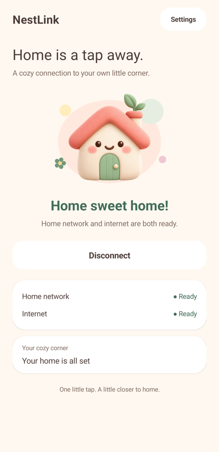

**English** | [简体中文](README.zh-CN.md)

# NestLink · 窝窝连

**One little tap. A little closer to home.**

NestLink is a cozy Android app that brings your home network along with you. It embeds ZeroTier and connects through your NAS gateway, so you can reach your home devices and the internet using a single Android VPN.


## A softer way home

A warm cream canvas, peach buttons, sage accents and a smiling little house. The everyday screen stays simple: one connection button, a clear status and two small connectivity checks.

- **English by default**, even on a device using another language. Switch to **简体中文** at the top of Settings; your choice is remembered without restarting the VPN.
- **Honest connection status.** “Home sweet home!” appears only after the NAS TCP check and certificate-verified HTTPS check both pass through the VPN.
- **Offline QR setup.** Scan with the camera or choose a photo, review the detected settings, then save. Display your own connection QR code for another device.
- **Live Moon status.** Compact helper lists show recent path availability and measured latency. Discovery alone is never shown as connectivity.
- **Developer tools stay tucked away.** Logs and peer details appear only after Developer mode is enabled.



## Get comfortable

1. Use Android 8.0 or newer. In Settings, scan a network QR code or enter your ZeroTier network ID and the NAS gateway’s ZeroTier IPv4 address.
2. Join the same ZeroTier network on your NAS and configure its mihomo gateway. See the [NAS reference](nas/README.md).
3. Tap **Let’s go home** and approve Android’s VPN request. A new device still needs approval in your ZeroTier controller.
4. NestLink checks the connection automatically and shows the result. You do not need the official ZeroTier client running alongside it.

The network ID alone cannot discover your NAS gateway. QR codes containing just a network ID preserve the gateway settings already entered on the phone.

## How the connection works

```text
Android apps → NestLink VPN → embedded ZeroTier → your NAS
                                                   ├─ home LAN: routing + NAT
                                                   └─ internet: mihomo TUN + rules
```

Checks bind to the app’s VPN network, with no explicit-proxy or physical-network fallback. The NAS check verifies its configured TCP service; HTTPS 204 verifies the selected test site at that moment, rather than every possible site or protocol.

Moon helper status uses actual ZeroTier receive timestamps for the configured Seed node. It requires a confirmed Moon role and a reply within 120 seconds from the current physical network. Snapshots refresh every five seconds and expire after fifteen seconds. This is separate from the NAS internet check.

## QR formats

- A plain, non-zero, 16-character ZeroTier network ID.
- `zerotier://<id>` or `zerotier://network/<id>`.
- Supported `my.zerotier.com/network/<id>` and `central.zerotier.com/networks/<id>` HTTPS links, parsed locally without opening the page.
- The existing `harborlink://join?network=<id>&gateway=<ipv4>&port=7890&moons=<encoded-list>` format remains compatible with earlier versions.

Camera frames and selected photos are decoded on-device using ZXing. No photo uploads, external scanner or Google Play Services are required. QR codes carry connection settings, never NAS passwords, subscriptions, controller API tokens or device identities.

## Build

JDK 17, Gradle 8.8, Android SDK 34 / Build Tools 34.0.0, NDK 27.2.12479018 and CMake 3.22.1.

```sh
./gradlew :app:assembleDebug :app:lintDebug
python3 tools/test_core.py
python3 tools/test_qr.py
python3 tools/test_i18n.py
```

Set `ANDROID_HOME` or put `sdk.dir` in your local `local.properties`. Windows native builds need a local or mapped drive rather than a UNC working directory. The debug APK is `app/build/outputs/apk/debug/app-debug.apk`; manage your own signing key for production distribution.

## A few boundaries

- One network and one same-subnet IPv4 NAS gateway are supported. IPv6 is blocked inside the VPN; IPv6-only physical networks are not supported yet.
- Always-on VPN, automatic startup and system-level lockdown are not implemented. Android restores the original network when the VPN closes.
- Moon helpers do not replace controller approval or become the internet gateway.
- Upgrading retains the app ID, connection settings and ZeroTier identity. Clearing data or uninstalling creates a new identity that needs approval again.
- Android system permission dialogs use the system’s language; NestLink’s own interface and connection notification use the selected app language.
- Not affiliated with ZeroTier Inc. The repository URL is retained from the earlier HarborLink name so existing links keep working.

See [validation notes](docs/VALIDATION.md), [third-party notices](THIRD_PARTY.md), and the [icon prompt/provenance](branding/PROMPT.md).

## License

NestLink application code is **GPL-3.0-or-later**. Vendored sources retain their original licenses. The nonfree ZeroTier controller is not built.
