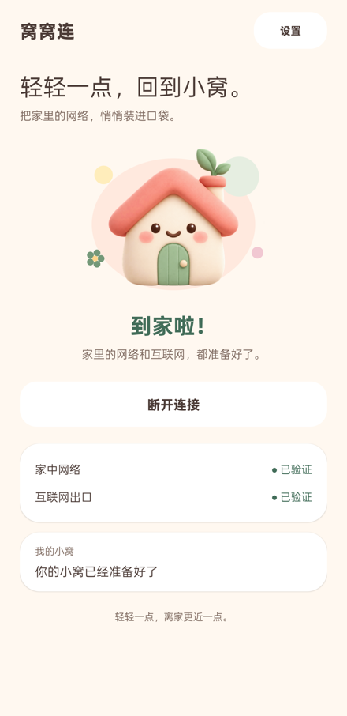

[English](README.md) | **简体中文**

# NestLink · 窝窝连

内置 ZeroTier，通过家中 NAS 的 mihomo 网关访问家庭内网和互联网。只占用一个 VPN，无需另开 ZeroTier 客户端。

- **Android 8.0+**：支持一键连接、扫码配置、Moon 节点与连接检测。
- **iPad 原型**：SwiftUI + Packet Tunnel，实际联网与部分真机交互仍待验收。见 [iPad 说明](ios/README.zh-CN.md)与[验证记录](ios/VALIDATION.md)。
- 支持英语、简体中文，详细诊断可在开发者模式查看。



## 快速开始（Android）

1. NAS 加入 ZeroTier 网络，配置 mihomo 网关，见 [NAS 配置](nas/README.md)。
2. 在 App 设置中扫码，或填写网络 ID、NAS 的 ZeroTier IPv4 地址和检测端口；Moon 可选。
3. 点击连接，允许 VPN，并在 ZeroTier Controller 授权新设备。

NAS TCP 与 HTTPS 检测均通过后显示已连接；检测结果仅代表指定服务和测试站点当时可达。

```text
设备 → NestLink VPN → ZeroTier → NAS → 家庭内网 / 互联网
```

## 构建 Android

需要 JDK 17、Gradle 8.8、Android SDK / Build Tools 34、NDK 27.2.12479018、CMake 3.22.1。
配置 `ANDROID_HOME`，或在 `local.properties` 中设置 `sdk.dir`。

```sh
./gradlew :app:assembleDebug :app:lintDebug
python3 tools/test_core.py
python3 tools/test_qr.py
python3 tools/test_i18n.py
```

APK：`app/build/outputs/apk/debug/app-debug.apk`。Windows 原生构建请使用本地盘或映射盘路径。
iPad 构建与签名见 [iPad 说明](ios/README.zh-CN.md)。

## 当前限制

- 单网络、同子网 IPv4 NAS 网关；VPN 内阻断 IPv6，暂不支持纯 IPv6 底层网络。
- Android 暂无始终开启、开机连接和系统级断线阻断；断开 VPN 后恢复原网络。
- Moon 辅助节点发现，不替代 Controller 授权或 NAS 出口。
- 升级保留配置与设备身份；卸载或清除数据后需重新授权。

## 许可

应用代码采用 **GPL-3.0-or-later**；第三方组件保留各自许可，不构建上游非自由 Controller。与 ZeroTier Inc. 无隶属关系。

[Android 验证记录](docs/VALIDATION.md) · [第三方声明](THIRD_PARTY.md) · [图标来源](branding/PROMPT.md)
